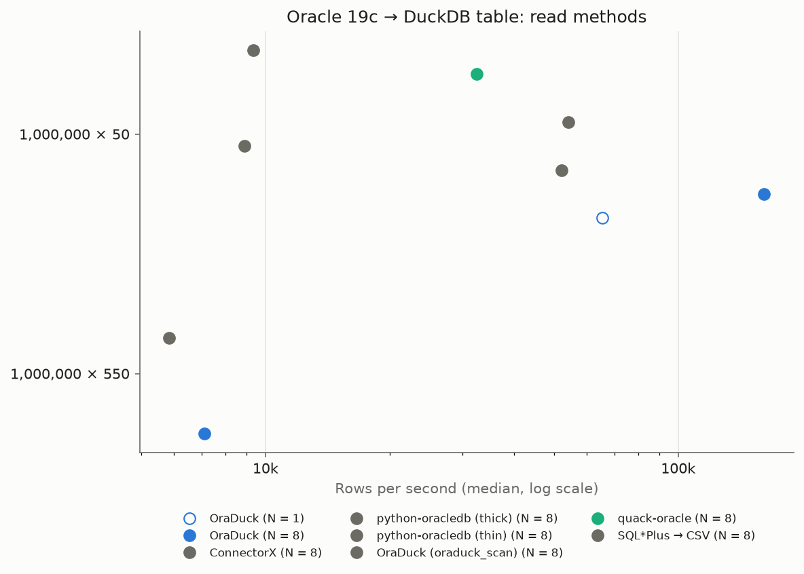

# OraDuck read benchmark: Oracle 19c → DuckDB

A partition of 1M rows (1M × 50 and 1M × 550 columns, wide tables with CLOBs) is read from Oracle into a new DuckDB table. Every number is a median of measured runs; methods are interleaved and checked against Oracle's checksums.

## Environment

- DuckDB v2.0.0, OCI client 19.32.0.0.0, Oracle 19.3.0.0.0 (free 19.3 registry image: the intended 19.30 needs a support contract)
- CPU 13th Gen Intel(R) Core(TM) i5-1340P; client on CPUs [0, 1, 2, 3, 4, 5, 6, 7], Oracle on CPUs 8-15; available memory 5.6 GB
- quack-oracle: 0.5.1 on DuckDB v2.0.0
- duckdb-oracle: 20d4389 on DuckDB v1.5.5
- oracledb: 26.0.1
- ConnectorX: 0.4.6
- sqlplus: SQL*Plus: Release 19.0.0.0.0 - Production Version 19.32.0.0.0

Timed scope, the same for every method: **first contact with Oracle to the rows stored in DuckDB**. Untimed: extension installation and loading, secret creation, and the checks done afterwards (row count, file size, column types, checksums). The threads setting is not the parallelism: the sessions column is what each method really opens.

| Method | Threads | Sessions | What the timer covers |
|---|---|---|---|
| ConnectorX | 8 | 8 | read_sql (partitioned) + insert of every batch |
| python-oracledb (thick) | 8 | 1 | connect + fetch_df_batches + insert of every batch |
| python-oracledb (thin) | 8 | 1 | connect + fetch_df_batches + insert of every batch |
| OraDuck | 1 | 1 | ATTACH + CTAS |
| OraDuck | 8 | 8 | ATTACH + CTAS |
| OraDuck (oraduck_scan) | 8 | 8 | CTAS |
| quack-oracle | 8 | 1 | ATTACH + CTAS (extension LOAD untimed) |
| SQL*Plus → CSV | 8 | 1 | sqlplus process start + connect + spool to CSV, then read_csv CTAS (start-up cannot be separated) |

## Matrix (OraDuck, unconstrained local link)

Median of 5 runs after one warm-up run; MB/s is DuckDB storage (database file) per second.

| Method | Threads | Rows | Columns | Median (s) | Min–max (s) | Rows/s | MB/s |
|---|---|---|---|---|---|---|---|
| OraDuck | 1 | 1,000,000 | 50 | 15.241 | 14.721–15.733 | 65,612 | 33.8 |
| OraDuck | 8 | 1,000,000 | 50 | 6.193 | 5.747–7.561 | 161,473 | 128.0 |
| OraDuck | 8 | 1,000,000 | 550 | 140.704 | 116.147–195.792 | 7,107 | 63.0 |
| OraDuck (oraduck_scan) | 8 | 1,000,000 | 550 | 170.917 | 101.079–302.720 | 5,851 | 51.9 |

## Competitors (unconstrained local link)

Median of 3 runs after one warm-up run, methods interleaved, checksums compared with Oracle's after every run: only methods that load identical data are ranked. Speedup = method median / OraDuck (N = 8) median. Each method ran in the DuckDB version of its column. Runs of the same method and case from several result files (read-matrix and read-competitors) are merged into one median.

| Rows | Columns | Method | N | Sessions | DuckDB | Median (s) | Min–max (s) | Rows/s | Speedup of OraDuck |
|---|---|---|---|---|---|---|---|---|---|
| 1,000,000 | 50 | ConnectorX | 8 | 8 | v2.0.0 | 19.194 | 18.829–21.115 | 52,099 | ×3.1 |
| 1,000,000 | 50 | python-oracledb (thick) | 8 | 1 | v2.0.0 | 112.579 | 105.361–125.959 | 8,883 | ×18 |
| 1,000,000 | 50 | python-oracledb (thin) | 8 | 1 | v2.0.0 | 18.459 | 16.745–20.097 | 54,176 | ×3.0 |
| 1,000,000 | 50 | OraDuck | 1 | 1 | v2.0.0 | 15.241 | 14.721–15.733 | 65,612 | ×2.5 |
| 1,000,000 | 50 | OraDuck | 8 | 8 | v2.0.0 | 6.193 | 5.747–7.561 | 161,473 | — |
| 1,000,000 | 50 | quack-oracle | 8 | 1 | v2.0.0 | 30.722 | 24.328–31.091 | 32,550 | ×5.0 |
| 1,000,000 | 50 | SQL*Plus → CSV | 8 | 1 | v2.0.0 | 106.924 | 100.380–112.866 | 9,352 | ×17 |
| 1,000,000 | 550 | OraDuck | 8 | 8 | v2.0.0 | 140.704 | 116.147–195.792 | 7,107 | — |
| 1,000,000 | 550 | OraDuck (oraduck_scan) | 8 | 8 | v2.0.0 | 170.917 | 101.079–302.720 | 5,851 | ×1.2 |

The sum of D1 (`NUMBER(25,9)`) is compared exactly, except within a relative 1e-12 for the methods that do not load it as `DECIMAL`: python-oracledb (thick), python-oracledb (thin).

Not ranked:

- duckdb-oracle (N = 8) on 1,000,000 × 50: **incorrect result** (not ranked): rinie_oracle N=8 RD_1000000_50 run 0: expected ReadChecksums(rows=1000000, sum_id=500000500000, len_v1=16152192, nulls_d1=49963, len_clob1=104805298, sum_d1='47573303766.558710995', epoch_dt1=1289080921766400, epoch_us_ts1=1289397100815250000000, c1_frequent=15106), got ReadChecksums(rows=1000000, s
- duckdb-oracle (N = 8) on 1,000,000 × 550: **incorrect result** (not ranked): rinie_oracle N=8 RD_1000000_550 run 0: expected ReadChecksums(rows=1000000, sum_id=500000500000, len_v1=16152192, nulls_d1=49963, len_clob1=104805298, sum_d1='47573303766.558710995', epoch_dt1=1289080921766400, epoch_us_ts1=1289397100815250000000, c1_frequent=15106), got ReadChecksums(rows=1000000, 

## Shaped to 1 Gbit/s

Utilisation = bytes received on the Oracle bridge during a run / total time / 125 MB/s (the link carries Oracle's traffic only; the total includes connection and planning time). The byte window brackets the whole method call, untimed set-up and checks included, and counts all traffic received on the bridge: the utilisation is an upper bound. Median over the runs.

No shaped run (`sudo ./infra/net/shape.sh on`, then `oraduck-bench read-shaped`).

## SQL*Net compression

No compression run (`oraduck-bench read-compression`).

## Planning share (OraDuck)

`Planning (ms)` of the OraDuck scan in one `EXPLAIN ANALYZE` per case, against the median time of the run (N = 8).

| Rows | Columns | Planning (ms) | Median (s) | Share |
|---|---|---|---|---|
| 1,000,000 | 50 | 14.9 | 6.193 | 0.2 % |
| 1,000,000 | 550 | 14.9 | 140.704 | 0.0 % |

## Pruned-unit overhead

No pruned-unit measurement (`oraduck-bench read-segments`).

## Success criteria

- Local: OraDuck is fastest on every case of the matrix: **met**
- Shaped to 1 Gbit/s: on 1M × 550, OraDuck reaches at least 90 % of line rate: **not evaluated** (no data)
- Correctness: identical checksums for every method that finishes: **not met** (incorrect result: duckdb-oracle on 1,000,000 × 50, duckdb-oracle on 1,000,000 × 550)

## Analysis

- **1M × 50, the case where competitors were measured**: OraDuck with 8 sessions has a median of
  6.193 s (161,473 rows/s). Against it, the medians are: python-oracledb thin 18.459 s (×3.0),
  ConnectorX 19.194 s (×3.1), quack-oracle 30.722 s (×5.0), SQL*Plus → CSV 106.924 s (×17) and
  python-oracledb thick 112.579 s (×18). Every OraDuck run matched Oracle's checksums.
- **Session for session**: OraDuck with one session (15.241 s, 65,612 rows/s) is also ahead of the
  methods that use one session: python-oracledb thin is 1.21 times slower (18.459 s), quack-oracle
  2.0 times (30.722 s), SQL*Plus 7.0 times (106.924 s) and python-oracledb thick 7.4 times
  (112.579 s) (ratios computed from the medians of the table). Going from 1 to 8 sessions brings
  OraDuck from 15.241 s to 6.193 s (×2.5). ConnectorX, with 8 partitions (8 sessions), is the only
  other parallel method, and it is 3.1 times slower than OraDuck at 8 sessions: it takes about as
  long as python-oracledb thin with a single session.
- **The order-of-magnitude gap**: python-oracledb thick (112.579 s) and SQL*Plus (106.924 s) are
  about 17 to 18 times slower. Thick goes through a slow fetch path for the CLOB column in this
  test; SQL*Plus timing includes the process start-up and the parsing of the CSV by DuckDB
  (start-up cannot be separated).
- **duckdb-oracle is not ranked**: its result is incorrect (the CLOB column arrives empty), so the
  checksums differ from Oracle's on 1M × 50 and on 1M × 550. A fast wrong result is not a result.
- **1M × 550: only OraDuck was measured.** With ATTACH the median is 140.704 s (7,107 rows/s,
  min–max 116.147–195.792 s) and with `oraduck_scan` 170.917 s (5,851 rows/s, min–max
  101.079–302.720 s); the two are within each other's spread, so the difference between them (×1.2
  in the table) says nothing. The competitor runs were stopped at the project owner's request
  because they took too long. The only competitor data on this case are single warm-up runs:
  quack-oracle 320 s and python-oracledb thin 477 s, against 217 s for OraDuck's warm-up. They are
  indicative only, and the protocol excludes warm-up runs from the medians.
- **The wide spread and the low rows/s point to the test environment, not to OraDuck** (likely cause,
  not investigated further): the 1M × 550 table is about 10 GB, while the Oracle container has a
  3 GB SGA and a 6 GB memory limit. Client and server share one 15 GB laptop, which was using swap
  (8 GB of swap in use during the campaign). Reading is probably bound by Oracle's disk reads and by
  memory pressure.
- **Planning share**: planning takes 14.9 ms, which is 0.2 % of the 6.193 s median of 1M × 50
  (0.0 % of 1M × 550).
- **Not measured in this campaign (owner's decision)**: the 1 Gbit/s shaped series, so the line-rate
  criterion is not evaluated; SQL*Net compression; the pruned-unit overhead (a pruned unit cost
  about 0.24 ms on 304 one-row subpartitions, measured during development, not part of this
  campaign).
- **Success criteria**: OraDuck is the fastest on the only case where competitors were measured
  (1M × 50): met. Line rate on 1M × 550 at 1 Gbit/s: not evaluated. Correctness: every OraDuck run
  matched Oracle's checksums; the "not met" in the generated criteria comes from duckdb-oracle's
  incorrect result, not from OraDuck.
- **Limits**: Oracle 19.3 in a container on the same laptop, so no network: reads over a 1 Gbit/s
  link will be bounded by the link (125 MB/s at most). Medians of 3 runs for the competitors and
  for OraDuck with 1 session, of 8 runs for OraDuck with 8 sessions on 1M × 50 (the 5 runs of the
  matrix and the 3 of the competitor series, merged) and of 5 runs for OraDuck on 1M × 550, with a
  high variance on 1M × 550. The 1M × 550 case does not compare OraDuck
  with anyone.

